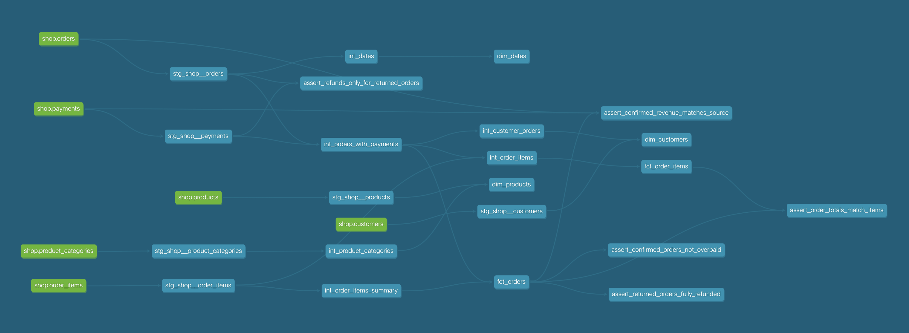

# Витрины интернет-магазина

Проект собирает аналитические витрины магазина в Greenplum с помощью dbt.
Исходные таблицы находятся в PostgreSQL. Сервис loader копирует их в Greenplum, в базу dwh и схему raw. После этого dbt строит факты и измерения.

## Запуск

Нужны Docker и Docker Compose. Python и dbt отдельно устанавливать не нужно.
Все команды выполняются из папки проекта.

```
docker compose up -d --build
docker compose logs loader
```

После успешной загрузки loader завершается с кодом 0. В логах должны быть следующие количества строк:

| Таблица | Строк |
|---|---:|
| customers | 40 |
| products | 13 |
| product_categories | 12 |
| orders | 141 |
| order_items | 444 |
| payments | 160 |

Установка пакета dbt_utils и сборка проекта:

```
docker compose run --rm dbt deps
docker compose run --rm dbt build
```

Ожидаемый результат сборки: ERROR=0 и WARN=1. Предупреждение связано с двойным списанием и описано ниже.

По умолчанию используется образ andruche/greenplum:7-4seg. Свой образ можно указать через переменную GREENPLUM_IMAGE в файле .env. Этот файл не включается в Git.

### Подключение к базам

| Параметр | PostgreSQL | Greenplum |
|---|---|---|
| Хост | localhost | localhost |
| Порт | 5436 | 5440 |
| База | shop | dwh |
| Пользователь | student | gpadmin |
| Пароль | studentpass | пустой |

Для обоих подключений в DBeaver можно выбрать драйвер PostgreSQL.

## Слои проекта

| Слой | Схема | Материализация | Назначение |
|---|---|---|---|
| staging | analytics_staging | view | Отдельная модель для каждой исходной таблицы |
| intermediate | analytics_intermediate | view | Соединения, агрегации и расчёт показателей |
| marts | analytics_marts | table | Готовые факты и измерения |

В staging нет соединений и агрегаций. Модели обращаются к источникам через source(), а к другим моделям — через ref().

Исключение — тест сверки с источником: он читает raw напрямую чтобы независимо проверить результат преобразований.

## Модель данных

```
erDiagram
    dim_customers ||--o{ fct_orders : customer_id
    dim_customers ||--o{ fct_order_items : customer_id
    dim_products ||--o{ fct_order_items : product_id
    dim_dates ||--o{ fct_orders : "date_day = order_date"
    dim_dates ||--o{ fct_order_items : "date_day = order_date"
    fct_orders ||--o{ fct_order_items : order_id
```

| Витрина | Одна строка | Для чего нужна |
|---|---|---|
| fct_orders | Заказ без тестовых заказов | Выручка, средний чек и итоги оплаты |
| fct_order_items | Один товар в заказе без тестовых заказов | Продажи по категориям, товарам и брендам; товары в возвращённых заказах |
| dim_customers | Клиент, включая клиентов без покупок | Доля покупателей по каналам привлечения, покупки и выручка клиента |
| dim_products | Товар | Названия, бренды и иерархия категорий |
| dim_dates | Календарный день | Отчёты по месяцам, кварталам и дням недели |

Подтверждённая покупка — заказ со статусом paid, у которого есть хотя бы одна успешная оплата, не являющаяся возвратом.

Возвраты записаны успешными платёжными операциями с отрицательной суммой. Перед соединением с заказами платежи агрегируются до одной строки на заказ.
Так несколько платежей не размножают строки заказа.

Выручку считаем по сумме подтверждённых заказов после скидок. Повторные списания её не увеличивают.

В dim_customers первая покупка определяется по времени оформления подтверждённого заказа. При одинаковом времени выбирается меньший order_id.
У клиента без покупок первая покупка равна null, количество покупок и выручка — 0.

items_count — число разных товаров в заказе, а не сумма quantity.

Дерево категорий разворачивается соединениями до трёх уровней. Для четвёртого уровня потребуется изменить intermediate-модель.

### Хранение в Greenplum

Настройки задаются в config() каждой витрины. Их применяет макрос macros/greenplum_create_table_as.sql.

| Витрина | Распределение | Хранение | Почему |
|---|---|---|---|
| fct_orders | По order_id | Колоночное, append-optimized | Ключ заказа подходит для соединения с позициями и платежами. В отчётах обычно читается часть колонок |
| fct_order_items | По order_id | Колоночное, append-optimized | Все позиции заказа попадают на один сегмент; удобно соединять с fct_orders и агрегировать по заказу |
| dim_customers | Репликация | Строковое | Маленькое измерение; локальная копия доступна каждому сегменту |
| dim_products | Репликация | Строковое | Небольшой справочник товаров, часто соединяется с позициями |
| dim_dates | Репликация | Строковое | Маленький календарь, используется в отчётах по обоим фактам |

Сырые orders, order_items и payments тоже распределены по order_id. Оба факта сохраняют этот ключ и его тип int. 

Если распределить fct_order_items по product_id, а fct_orders по order_id, для соединения по заказу может понадобиться пересылка данных между сегментами.

Репликация клиентов подходит для текущего небольшого набора.
Проверка распределения и способа хранения (sql):

```
select
    c.relname,
    pg_get_table_distributedby(c.oid) as distribution,
    am.amname as storage
from pg_class c
join pg_namespace n on n.oid = c.relnamespace
left join pg_am am on am.oid = c.relam
where n.nspname = 'analytics_marts'
  and c.relkind = 'r'
order by c.relname;
```

### Граф зависимостей



## Тесты

Для первичных ключей staging и marts используются unique и not_null.
Внешние ключи фактов проверяются через relationships, статусы — через accepted_values.

Свой generic-тест non_negative проверяет order_amount и items_count.
Отдельные SQL-тесты проверяют

1) совпадение суммы заказа с суммой его позиций;
2) совпадение выручки и числа подтверждённых заказов с исходными данными;
3) полный возврат денег по возвращённым заказам;
4) отсутствие переплаты по подтверждённым заказам;
5) наличие возвратов только у заказов со статусом returned.

### Двойное списание

Тест assert_confirmed_orders_not_overpaid настроен на severity - warn.
У заказа 113 сумма заказа — 200 рублей, а успешных оплат — две,
по 200 рублей каждая. Итого списано 400 рублей.

Тест показывает предупреждение. Исходные данные не исправляются, расхождение нужно видеть при проверке качества данных.

## Дополнительное задание

Подключён пакет dbt_utils версии 1.3.0.

В stg_shop__order_items используется generate_surrogate_key, ключ позиции формируется из order_id и product_id.
packages.yml и package-lock.yml включаются в репозиторий.
Папка dbt_packages создаётся командой dbt deps и в Git не добавляется.

## Контрольные значения

Ожидаемые результаты для учебных данных

| Проверка | Результат |
|---|---|
| fct_orders | 135 строк |
| Подтверждённые заказы | 106 |
| Выручка подтверждённых заказов | 91 620,00 руб. |
| fct_order_items | 425 строк |
| Сумма подтверждённых позиций | 91 620,00 руб. |
| dim_customers | 40 клиентов: 29 покупателей и 11 без покупок |
| Клиент 1 | Первый заказ 101; 9 покупок на 7 280,00 руб. |
| Клиент 40 | is_buyer = false, первая покупка — null |
| dim_products | 13 товаров |
| Товар 11 | Home → Kitchen → Cookware |
| Товар 12 | Electronics → Accessories → Cases |
| Выручка Electronics | 59 994,28 руб. |
| Выручка Home | 31 625,72 руб. |
| dim_dates | 133 дня: с 2026-03-01 по 2026-07-11 |
| Тест переплаты | Одно предупреждение, заказ 113 |

## Документация dbt

```
docker compose run --rm dbt docs generate
docker compose run --rm --service-ports dbt docs serve --host 0.0.0.0 --port 8080 --no-browser
```
Документация доступна по адресу http://localhost:8080.
Остановить сервер можно через Ctrl+C.
Определение подтверждённой покупки находится в блоке `confirmed_order`, а обзор проекта — в блоке `__overview__`.
Оба блока описаны в файле `models/docs.md`.

## Повторная загрузка и чистая сборка

Повторно скопировать данные из PostgreSQL

```
docker compose run --rm loader
docker compose run --rm dbt build
```

Пересоздать базы с нуля

```
docker compose down -v
docker compose up -d --build
docker compose logs loader
docker compose run --rm dbt deps
docker compose run --rm dbt build
```

down -v удаляет том с данными PostgreSQL
В этой конфигурации данные Greenplum хранятся внутри контейнера:
при его удалении они тоже теряются. Loader и dbt восстанавливают учебные данные и витрины.

Папки target, logs и dbt_packages не включаются в репозиторий. 
